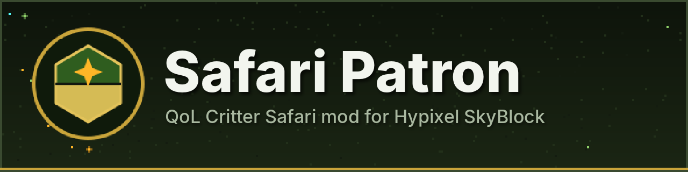
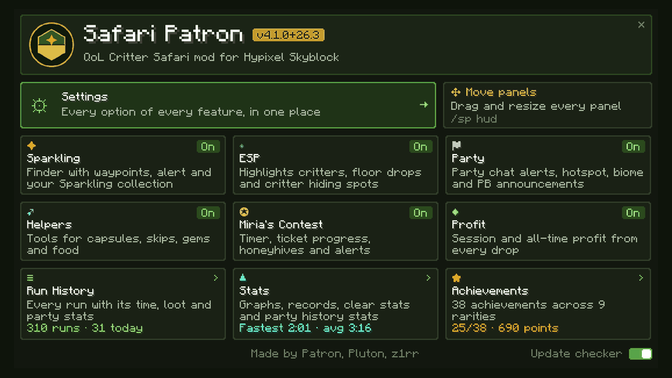

  

  <b>Everything you need for Critter Safari, in one mod.</b> 
  Find sparklings, track your runs and profit, coordinate your party and chase achievements.

  
  
  
  

  <b><a href="#features">Features</a></b> ·
  <b><a href="#installing">Installing</a></b> ·
  <b><a href="#commands">Commands</a></b>

  

## Features

<table>
<tr>
<td width="33%" valign="top">

### ✦ Sparkling Finder
Spots Sparkling critters and marks them in the world until caught. 
Share their location in one click. 
Your Critterdex sparklings, synced from the game.

</td>
<td width="33%" valign="top">

### 📋 Safari HUDs
Your and your party's uniques per biome. 
Run timer, splits and missing critters. 
Every panel can be moved and resized.

</td>
<td width="33%" valign="top">

### ⚑ Party Messages
Warp check, hotspot sharing and biome announcements. 
Completion times with personal bests. 
Each message can be turned off.

</td>
</tr>
<tr>
<td width="33%" valign="top">

### ☰ Run History
Up to 20,000 runs with time, loot and party. 
Filters for sparkling, PB and Dye runs. 
Each player in their biome's color.

</td>
<td width="33%" valign="top">

### ▲ Stats
Run time and profit graphs. 
Clear stats, sparkling rate and records. 
The players you play with most.

</td>
<td width="33%" valign="top">

### ★ Achievements
38 achievements across 9 rarities. 
From Common to Impossible, 2,400 points. 
Your past runs count too.

</td>
</tr>
<tr>
<td width="33%" valign="top">

### ♦ Profit Tracker
Session and all-time profit, item by item. 
Bazaar and auction house prices. 
Top shards of each biome.

</td>
<td width="33%" valign="top">

### ✪ Miria's Contest
Time left, bracket, score and ticket. 
Warnings before the contest ends. 
Honeyhive waypoints and refill timers.

</td>
<td width="33%" valign="top">

### ◈ ESP
Critters and floor drops through walls. 
Bee nests and Snoozle walls. 
Clear water in the Safari.

</td>
</tr>
<tr>
<td width="33%" valign="top">

### ➶ Capsule Helper
Shows where your capsule will fly. 
Tells you if it will hit a critter.

</td>
<td width="33%" valign="top">

### ⚙ Main Menu
Every feature and setting in one place. 
Search through every option. 
Open with `/sp`.

</td>
<td width="33%" valign="top">

### ✨ Quality of Life
Pick Hideyho's `[Sure]` with one click in chat. 
Update checker. 
Reset buttons ask before deleting.

</td>
</tr>
</table>

<b>All features in detail</b>

### 📋 Safari HUDs
- **Run Stats HUD:** Tracks your and your party's unique catch per biome and global. Includes Run Timer and Run splits.
- **Run Timer:** Starts when you entered in Critter Safari.
- **Run Splits:** Includes party member's unique catches per biome.
- **Missing Critters Hud:** Shows the remaining uncaptured unique critters in the biome.
- **Sparkling HUD:** When a Sparkling Critter is spotted, it appears on the screen. It remains there until it is caught.
- **Alert HUD:** It alerts you as to whether all players have warped into the area or someone missing.
- **Done HUD:** Biome completion alerts. Includes per biome or every area. (with and without Macaw)
- **Sparklings HUD:** Shows which sparklings you have caught in your current biome. Can list only the missing ones.
- **Total Sparklings HUD:** All 37 sparklings in four columns, shown in the middle area between the biomes.
- **Contest HUD:** Miria's Contest time left, bracket, score and ticket status.
- **Achievement Panel:** A box on screen when you unlock an achievement. Choose the lowest rarity it shows, or turn it off.
- **Completion Times:** Biome announcements show your time and personal best, e.g. `Forest Done! Completed in 2:31 (PB 2:20 by IGN)`.

### ✦ Sparkling Finder
- **Sparkling ESP:** Spots Sparkling critters and boxes.
- **Sparkling Waypoint:** Marks the critter with a box in the world when seen. Waypoint disappears after catching.
- **Sparkling Share:** One-click buttons to share its location in party or all chat.
- **Auto Share:** Optionally sends every Sparkling straight to party chat.
- **Critterdex Sync:** Opening the Sparkling Critterdex in game updates your sparklings list automatically.
- **Last Sparkling:** When a Sparkling is caught, tells you how many runs and how long ago the previous one was.

### ➶ Capsule Helper
- Shows where your capsule will fly and whether it will hit a critter.

### ✪ Miria's Contest
- **Contest Tracker:** Time left, bracket and score, read from the scoreboard.
- **Ticket Message:** Sends `Ticket earned!`, `r` or your own text to party chat when your Basic or First-Class ticket is earned.
- **Start Message:** Sends `New Miria's Contest started.`, `!dt contest` or your own text to party chat when a new contest starts.
- **Incomplete Warnings:** Title and sound if your ticket isn't done. 5 minutes left by default, 3 and 1 minute can be turned on too.
- **Honeyhives:** During a contest every full Honeyhive in Torrhus Canyon gets a waypoint. A looted hive shows its one-hour refill timer, and the contest panel shows how many are ready.

### ♦ Profit Tracker
- **Session Profit:** Shard, Safari Essence, Rainbow Feather and Emerald Dye profits, total, run count, average run time and profit per hour.
- **Session Clock:** Starts when the Safari Manager takes your ticket and pauses when you're away from the Safari.
- **Total Profit Tracker:** All-time profit item by item, in rarity colors, with total runs and total profit. Shows at the Critter Safari Entrance by default, or everywhere outside the Safari. Never inside the Safari.
- **Emerald Dye:** Your own Emerald Dyes count too, at the Auction House's lowest BIN price.
- **Top Shards:** `/sp topshards` lists each biome's 5 most profitable shards in chat.
- **Scroll Support:** Choose how many items it shows (5, 10, 15 or 20); scroll with your mouse wheel over the panel while an inventory is open.
- **Bazaar Prices:** Choose Instant Sell or Sell Offer prices. Warns you when prices can't be loaded instead of showing 0.
- **Safe Data:** Settings, profit, run history and achievements are saved in their own folder, `config/safari-patron/`, and kept between updates.

### ☰ Run History
- **Every Run Saved:** Time, uniques (yours and the party's), catches, profit and loot of up to 20,000 runs, saved in small files so the game never stutters.
- **Run Details:** Biome completion times, every party member's uniques in the color of the biome they did, sparklings and who caught them, item-by-item loot.
- **Filters and Sorting:** Show only sparkling runs, record runs, Emerald Dye runs, today or this week; sort by newest, fastest or most profitable.
- **Overview:** Total runs, time played, total profit, fastest run and your sparkling rate at a glance.
- **Stats:** Run time and profit graphs with your all-time average, your last 10 runs against your average, clear stats per biome, sparkling stats, records and the players you play with most. Choose all time, this week, today or the last 50 runs.
- **Achievements:** 38 achievements across 9 rarities, from Common to Impossible, with points, progress bars and rarity filters. Your past runs count too.
- Open it with `/sp history` or from the main menu.

### ⚑ Party Messages
- **Warp Check:** Sends `[✦SP✦] 4/4 Players in Safari.` or `[✦SP✦] Someone missing!` in party chat.
- **Hotspot Sharing:** It shares the hotspot area assigned to you in the party chat.
- **Biome Announcements:** {Area} Done!, Everything except Macaw done!, Everything Done!
- **Best Parties:** Your Everything PBs remember who was in your party. `/sp bestparty` shows them in chat, each player in the color of the biome they started in.
- **Alert panels:** Each alert can go to party chat, your screen, or both. 

### ◈ ESP System
- **Sparkling ESP:** Spots Sparkling critters and alerts you in chat with their distance and coordinates. Marks the critter with a box in the world.
- **Critter ESP:** Boxes around critters.
- **Floor Drop ESP:** Marks floor drop spots.
- **Bee Nest ESP:** Honeybug nests in Forest.
- **Snoozle Walls:** Breakable walls in Cavern.
- **Clear Water:** See through the water in the Safari, with adjustable opacity.

### ✨ Quality of Life
- **Main Menu:** `/sp` opens a menu with every feature, its settings, and your Run History, Stats and Achievements.
- **Settings:** Every setting in one place, with search.
- **HUD Editor:** /sp hud lets you drag and resize every panel, with center guides that snap.
- **Hideyho:** With chat open, click anywhere in it to pick `[Sure]`
- **Update Checker:** Tells you in chat when a new version is out. Can be turned off on the main menu.
- **Safe Resets:** Reset buttons ask for a second click before anything is deleted.

## Installing

1. Install **Fabric Loader 0.19.5 or newer** for your Minecraft version (26.3 or 26.2) using the [Fabric installer](https://fabricmc.net/use/installer/).
2. Download these mods and put them in your `mods` folder:
   - **Safari Patron**: pick the jar that matches your Minecraft version from the [Releases](../../releases) page
     - Minecraft 26.3 → the jar ending in `+26.3.jar`
     - Minecraft 26.2 → the jar ending in `+26.2.jar`
   - [**Fabric API**](https://modrinth.com/mod/fabric-api), for the same Minecraft version
   - [**Fabric Language Kotlin**](https://modrinth.com/mod/fabric-language-kotlin)
   - *Optional:* [**Mod Menu**](https://modrinth.com/mod/modmenu), for a settings button in the mod list
3. Launch the game, join Hypixel and type `/sp` to open the menu.

## Commands

| Command | Description |
|---|---|
| `/sp` | Open the main menu |
| `/sp settings` | Open the settings |
| `/sp hud` | Move and resize the panels |
| `/sp history` | Open your run history, stats and achievements |
| `/sp topshards` | Show each biome's most profitable shards in chat |
| `/sp bestparty` | Show the parties of your Everything PBs in chat |
| `/sp help` | List all commands in chat |
| `/sp sparkling` | Toggle the Sparkling Finder |
| `/sp sparkling sound` | Toggle the Sparkling sound |
| `/sp sparkling clear` | Clear the Sparkling panel |
| `/sp esp` | Toggle critter ESP |
| `/sp floor` | Toggle floor drop ESP |
| `/sp capsule` | Toggle the Capsule Helper |
| `/sp contest` | Toggle the Miria's Contest tracker |
| `/sp sessionprofit` | Show your session profit in chat (click to copy) |
| `/sp totalprofit` | Show your all-time Safari profit in chat (click to copy) |
| `/sp resetsession` | Start a new profit session |
| `/sp warp` | Toggle the warp check in party chat |
| `/sp hotspot` | Toggle Hotspot sharing in party chat |
| `/sp announce` | Toggle biome announcements in party chat |
| `/sp prefix <style>` | Chat prefix style: `safari`, `gold`, `emerald`, `sunset`, `aurora` |
| `/sp status` | Show your current run status |
| `/sp newrun` | Manually reset the run |

Every toggle is also available in the `/sp` menu.

## License

Safari Patron is released under the [Apache License 2.0](LICENSE). See [NOTICE](NOTICE) for attribution.

Some parts are based on code and data from other open-source projects, which keep their own licenses. See the [`licenses`](licenses) folder for details.
